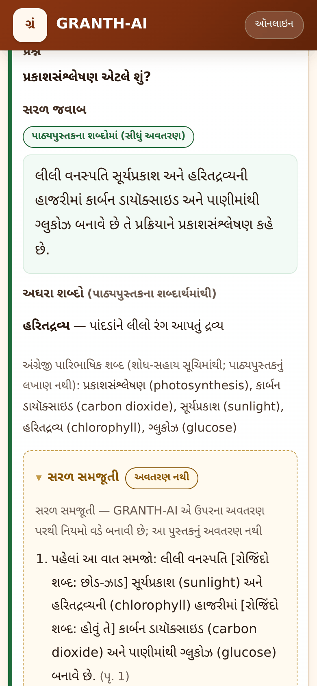
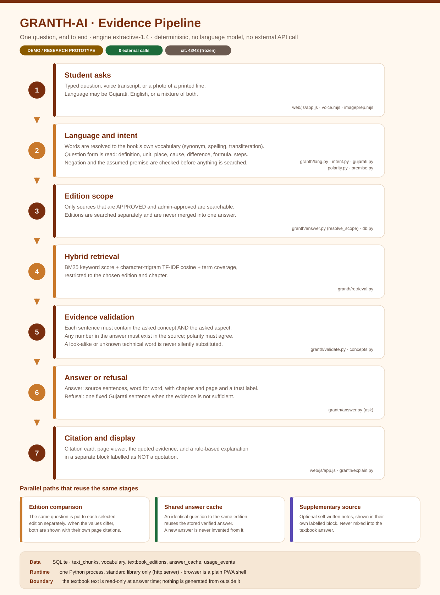
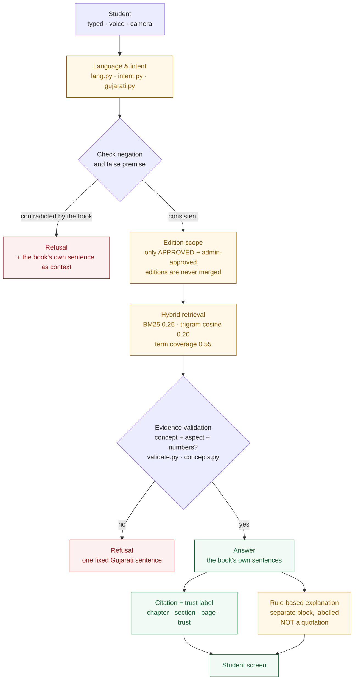
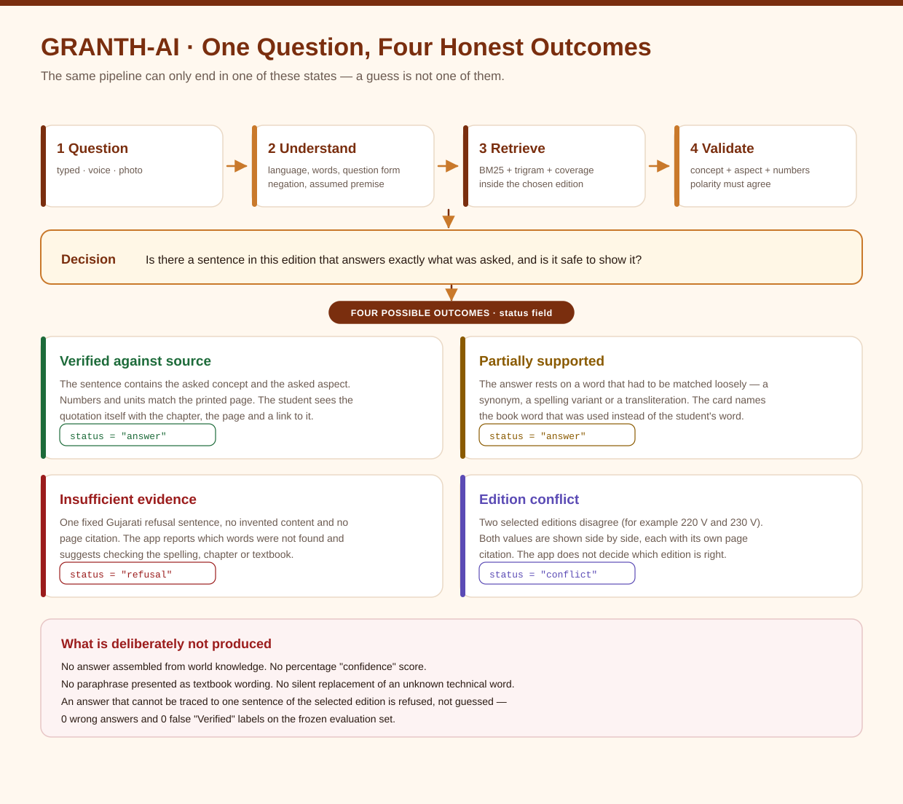

<div align="center">


# 📚 GRANTH-AI

### Textbook-Grounded AI Learning Assistant

**Learn from your textbooks. Ask naturally. Understand with evidence.**

[](#-status-and-scope)
[-7a2e0e?style=flat-square)](#-how-it-works)
[](#-testing-and-benchmark-results)
[](granth/__main__.py)
[](#-testing-and-benchmark-results)
[](#-privacy-and-security)
[-blue?style=flat-square)](LICENSE)

[Overview](#-project-overview) · [Features](#-core-features) · [Architecture](#-architecture) · [How it works](#-how-it-works) · [Run it](#-installation-and-local-setup) · [Results](#-testing-and-benchmark-results) · [Limits](#-limitations-and-transparency) · [Docs](docs/README.md)

</div>

---

## 👋 A note to a first-time reader

GRANTH-AI is a working research prototype that answers a student's question **using only the sentences of
the textbook they selected**, and shows the chapter and page. When the textbook does not support an answer,
it says so instead of guessing.

It is **not** a chatbot that knows Science. It is a small, auditable engine that finds the right sentence in
the right book and proves where it came from. Everything below — results, screenshots, limitations — was
produced by this repository, and you can reproduce it on your own machine in a few minutes.

> **The project exists to answer one question honestly:** *can a computer help a Gujarati-medium student
> understand their own textbook without ever telling them something the textbook does not say?*
> On the demo material it can: 42 of 59 answerable questions were answered correctly, with **zero wrong
> answers** — and 19 questions that could have been answered were refused instead. That trade-off is
> deliberate, and closing it is the next engine's job.

<div align="center">

<br>
<sub><b>A real answer card</b>, captured from the running demo. The answer is the textbook's own sentence.<br>
The explanation underneath is generated by rules and is explicitly labelled <i>not a quotation</i>.<br>
<i>The demo interface is in Gujarati and uses a few emoji; the container this documentation was captured in
has no emoji font, so those few show as small boxes in the images. They render normally in a real browser.</i></sub>
</div>

---

## 🎯 Project overview

### What GRANTH-AI is

A local, offline-capable web application (`python -m granth serve`, no cloud) with:

- a **question-answering engine** that is deterministic and rule-based (`extractive-1.4`);
- a **validation layer** that refuses any answer sentence that does not contain both the concept asked about
  and the thing asked for (unit, place, cause, definition, formula, …);
- a **citation layer** that names the board, standard, subject, book, edition, chapter, section and page;
- a **student interface** in Gujarati (with English and mixed-language questions accepted) that also
  offers revision, practice questions, a textbook dictionary, an offline library, private notes, optional
  voice input and optional camera/OCR input.

### Why it is being developed

Students in Gujarati-medium schools study from printed textbooks. Three things are hard:

1. **The textbook's language is not the student's language.** Formal Gujarati ("ઑક્સિજનની ગેરહાજરીમાં થતા
   શ્વસનને અજારક શ્વસન કહે છે") is not how a fifteen-year-old asks a question.
2. **Finding the sentence is the actual work.** The fact exists on one page of a 200-page book. A general
   chatbot answers from memory; a student needs the page.
3. **Confident wrong answers are worse than no answer.** For a learner, an answer that sounds right and is
   wrong is more damaging than "I cannot find this in your book".

### The problem it addresses

| Student problem | What GRANTH-AI does about it | Does it work? |
|---|---|---|
| "I don't understand the textbook's wording" | Rule-based simplification: splits long sentences at safe joints, puts everyday words in `[square brackets]`, English terms in `(round brackets)`, all labelled as the app's own word list, never as textbook text | Works, but the simplification is shallow — see [the explanation report](docs/EXPLANATION_QUALITY_REPORT.md) |
| "I can't find the right passage" | Hybrid retrieval inside the selected edition only, then sentence-level validation | Works; the page citation was correct in **43 of 43** answers on the frozen set |
| "I can't ask in my language" | Gujarati, English and mixed questions; English words are mapped to the book's Gujarati terms and the mapping is shown | Works for Gujarati; **English is the weakest area (7/10 on the frozen set)** |
| "Where did this answer come from?" | Every answer sentence is a verbatim substring of a stored chunk, with chapter + page + a page viewer; a refusal carries no citation at all | Works; enforced by tests and by the API |
| "Is this AI making things up?" | A sentence that fails validation is never shown; unknown or look-alike technical words are refused with a "did you mean" suggestion; the default configuration makes **zero** external API calls | Works on the demo corpus: **0 wrong answers, 0 false "Verified" labels** on 102 frozen questions |

### What makes it different

- **Evidence first, answer second.** The engine chooses *sentences*, not words. `answer.parts[].text` is always
  a substring of `evidence[].text`, and a test asserts it for every answer in the suite.
- **It can say no.** "આ પસંદ કરેલા પાઠ્યપુસ્તકમાં આ પ્રશ્નનો પૂરતો આધાર મળ્યો નથી." is a first-class outcome
  with its own UI state, trust label and tests — not an error path.
- **No model, no key, no cost.** The default path needs no LLM, no API key and no internet. The optional
  generative providers in `.env.example` are **off**, and every run in this repository made **0** external calls.
- **Editions are never merged.** If two editions disagree (220 V vs 230 V), both are shown with their own
  pages and the app refuses to pick a winner.

---

## 📍 Status and scope

| | |
|---|---|
| **Status** | 🟡 **DEMO / RESEARCH PROTOTYPE — not production-ready** |
| **Engine** | `extractive-1.4`, frozen (changing it requires a new version and a new frozen set) |
| **Last verified** | Engine and measurements: Phase 5 commit `b147637`. This presentation: branch `release/granth-ai-public-showcase`. |
| **Corpus** | **14 pages of self-written demo text.** Not a real board textbook. |
| **Real publishers supported** | **None.** GSSTB: UNKNOWN · NCERT: DENIED · DIKSHA: UNKNOWN |
| **Validated by** | The developer only. No teacher review, no student study, no physical-device test |

<details>
<summary><b>Why a demo corpus and not a real textbook?</b> (click)</summary>

Because using a real textbook requires the publisher's permission, and permission is a legal matter, not a
technical one. The registry in [`docs/SOURCE_PERMISSION_REGISTER.md`](docs/SOURCE_PERMISSION_REGISTER.md)
records the status of each publisher, and the request letter is written and waiting in
[`docs/templates/PUBLISHER_PERMISSION_REQUEST.md`](docs/templates/PUBLISHER_PERMISSION_REQUEST.md).
It has **not** been sent.

So the engine is demonstrated on three small books written for this project
("GRANTH-AI Sample Board (demo – NOT GSEB)") under CC BY 4.0. They contain real curriculum facts
(photosynthesis, Ohm's law, pH, reflection, the Preamble, …) so that the engine has something true to
reason about.
The software does not depend on the demo: a new book is added by writing a `book.json` and ingesting it.

</details>

---

## ✨ Core features

Every row below was checked against the source, not from memory. "Verified" means: covered by an automated
test that ran at this commit.

### Answering

| Feature | What it does | How a student uses it | Verification |
|---|---|---|---|
| **Gujarati question answering** | Understands definition, naming, unit, quantity, place, cause, type, difference, formula and step-by-step question forms | Types a question in Gujarati | ✅ verified — 62 of 73 Gujarati frozen questions as expected |
| **English and mixed-language questions** | Maps English terms to the book's Gujarati terms and shows the mapping note | `What is photosynthesis?` · `વિદ્યુતપ્રવાહનો unit કયો છે?` | ⚠️ works, weakest area — 13/20 English, 8/9 mixed |
| **Textbook-grounded retrieval** | BM25 + character-trigram cosine + term coverage, restricted to the selected edition | Automatic | ✅ verified — precision enforced by tests |
| **Evidence validation** | Each sentence must contain the asked concept **and** the asked aspect; numbers must exist in the source | Automatic — this is what makes refusals happen | ✅ verified |
| **Page citations** | Board, standard, subject, book, edition, chapter, section, page + a page viewer | Taps the page link under an answer | ✅ verified — 43/43 lead citations correct |
| **Refusal when evidence is insufficient** | One fixed sentence, no answer, no citation | Asks something the book does not cover | ✅ verified — 34/34 correct refusals |
| **Question intent classification** | Shows the student *how the question was understood* and which words were checked | Small grey line under the answer | ✅ verified |
| **Edition comparison** | Opt-in: the same question is asked of every selected edition separately; disagreements are shown side by side | Checklist on the textbook-selection screen | ✅ verified — new browser step, 220 V vs 230 V with both pages |
| **Safe simplified explanation** | Splits sentences at safe joints, adds everyday words and English terms, all labelled as not the textbook | Opens the "સરળ સમજૂતી" panel | ✅ verified — every line traced to a page; one wrong gloss found and documented |
| **Formula lookup** | Finds the named formula and shows the sentence that states it | "ઓહ્મનો નિયમ લખો" | ✅ verified |
| **Answer cache** | An identical question to the same edition reuses the stored verified answer | Automatic | ✅ verified — flagged on the card as a cache hit |

### Studying

| Feature | What it does | Verification |
|---|---|---|
| **Exam mode** | Builds a 1–5 mark answer from evidence and warns when the book cannot fill the requested length | ✅ verified |
| **Chapter revision & practice questions** | Revision sheet from the chapter's definitions and formulas; practice questions with page references | ✅ verified |
| **Textbook dictionary** | Search the chapter's own vocabulary, save words | ✅ verified |
| **Offline library** | Downloads an authorised book into the browser (IndexedDB), verified page by page, readable and searchable with the network cut | ✅ verified — the browser suite really goes offline |
| **Private session notes** | A student's own notes, with a rights confirmation, never cached, never published, deletable | ✅ verified — a test asserts notes never appear in the public catalogue |
| **Voice input** | Web Speech API; the transcript lands in the editable box and is **never** auto-submitted | ⚠️ works against a mock recogniser; **not tested on a real microphone** |
| **Camera / OCR input** | On-device Tesseract.js OCR of a printed line, with rotate/crop and an editable result | ⚠️ works on a generated printed image in a headless browser; **not tested on a real camera** |
| **Read answers aloud** | `speechSynthesis` in Gujarati when the device has a Gujarati voice | ⚠️ graceful, but not validated on a device |

### Administration

| Feature | What it does | Verification |
|---|---|---|
| **Source permission registry** | Every edition carries a permission status; only APPROVED + admin-approved editions are searchable or downloadable | ✅ verified |
| **Admin review page** | Shared-token page to approve/reject an ingested edition and to see learner feedback | ✅ verified (token refusal + reject/approve flow) |
| **PDF ingestion with Gujarati OCR** | PDF → text → chapters → chunks → vocabulary, behind the admin review gate | ✅ verified on a printed sample PDF (mean character error 6.5 %) |

**Not implemented** (and deliberately not claimed): accounts or logins, teacher dashboards, per-school
deployment, cloud sync, embeddings-based retrieval, any LLM in the default path.

---

## 🏗 Architecture

<div align="center">

</div>

### The same flow as a Mermaid diagram



### The four outcomes

<div align="center">

</div>

| Student sees | API `status` | Looks like | Never |
|---|---|---|---|
| ✅ Verified answer | `answered` + `trust.status = verified` | Green edge, "સીધું અવતરણ" label, page link | never contains a paraphrased sentence |
| ⚠️ Partially supported | `answered` + `trust.status = partial` | Amber edge, reason lines, the matched book word is named | never hides that a word had to be assumed |
| 🚫 Refusal | `abstained` | Amber edge, the fixed refusal sentence, no citation | never carries a page number or an answer |
| 🔀 Edition conflict | `edition_conflict` | Violet edge, one block per edition with its own page | never picks one value as "the" answer |

### Module map

| Layer | Files | Responsibility |
|---|---|---|
| HTTP | `granth/api.py`, `granth/__main__.py` | 31 JSON endpoints on `http.server`, static files, admin token, rate limiting |
| Orchestration | `granth/answer.py` (1 069 lines) | scope resolution, mode detection, composition, validation, trust, refusal, cache, persistence |
| Understanding | `lang.py`, `intent.py`, `gujarati.py`, `polarity.py`, `premise.py`, `concepts.py` | normalise, resolve words, read the question form, check negation and the assumed premise |
| Retrieval | `retrieval.py` | BM25 + character-trigram TF-IDF cosine + coverage, per edition/chapter |
| Validation | `validate.py` (426 lines) | sentence-level checks: concept, aspect, numbers, polarity |
| Explanation | `explain.py` | rule-based restatement with a verifier (`verify()`) that rejects changed numbers or added facts |
| Study | `study.py`, `concepts.py` | revision sheets, practice questions, vocabulary |
| Ingestion | `ingest.py`, `structure.py`, `ocr.py` | PDF → text → chapters → chunks → vocabulary, with permission gating |
| Storage | `db.py`, `migrations/*.sql`, `cache.py` | SQLite schema, migrations, verified-answer cache |
| Providers | `providers.py`, `cost.py` | optional generative providers (default OFF) and call accounting |
| Interface | `web/index.html`, `web/styles.css`, `web/js/app.js`, `web/js/*.mjs`, `web/sw.js` | single-page app, service worker, offline library, voice, OCR |

The full description, including the invariants the engine must not break, is in
[`docs/ARCHITECTURE.md`](docs/ARCHITECTURE.md).

---

## ⚙️ How it works

### Step by step

1. **Scope.** The student's selection is turned into a set of edition ids (`answer.resolve_scope`). An edition
   is searchable only if its permission status is APPROVED **and** an admin approved it. Editions are handled
   separately (`edition_results`) and are never concatenated.
2. **Normalise.** Gujarati text is normalised (matras, common spelling variants, ZWJ/ZWNJ). English words are
   mapped to Gujarati terms through the project's own word list; unmapped words are reported to the student.
3. **Resolve words.** Each content word of the question is matched against the book's actual vocabulary, in
   increasing order of risk: exact → compound → synonym → spelling variant → conservative fuzzy → root. A
   fuzzy match must clear a confidence threshold **and** co-occur with its context, otherwise the question is
   refused with a "did you mean" suggestion. A look-alike technical word (વૉટમીટર vs વોલ્ટમીટર) is never
   silently replaced.
4. **Read the question.** The form of the question decides what a valid sentence must contain: a *unit*
   question needs the unit, a *place* question needs a place, a *difference* question needs the comparison.
   Negation ("ઑક્સિજન ન હોય ત્યારે", "without oxygen") and the assumed premise are checked here, before
   retrieval.
5. **Retrieve.** Hybrid score = `0.55 × term coverage + 0.25 × BM25 + 0.20 × trigram cosine`, computed only
   over chunks of the selected edition (and chapter, if one is selected).
6. **Compose.** Candidate sentences are filtered by the validator. A sentence that only *names* the concept,
   or that answers a different aspect of it, is rejected — this is what stopped the engine from answering
   "અંતર્ગોળ અરીસો ક્યાં વપરાય છે?" with the mirror's definition.
7. **Validate and label.** If the best sentence passes, the answer is assembled from it verbatim; the trust
   label is `verified` for exact/synonym matches and `partial` when the match rested on an assumed word.
   If nothing passes, the answer is `abstained` with the fixed refusal sentence.
8. **Explain.** A separate, rule-based explanation is built and verified (`explain.verify`): every piece must
   be a substring of the quoted sentence, the digits must be identical, and no content word may be added
   except fixed template words. If the check fails, no explanation is shown.
9. **Record.** The result is logged in `usage_events`; identical questions to the same edition can be served
   from `answer_cache`, flagged as a cache hit.

### Illustrative demo example

> **This is the demo corpus**, i.e. text written for this project — *not* a real textbook. The output below
> was produced by `python -m granth serve` at this commit; nothing is invented for the README.

**Question** (Gujarati, definition form): `પ્રકાશસંશ્લેષણ એટલે શું?`

**Answer** — `status: answered`, `trust: verified`, one sentence, source type `quotation`:

> લીલી વનસ્પતિ સૂર્યપ્રકાશ અને હરિતદ્રવ્યની હાજરીમાં કાર્બન ડાયૉક્સાઇડ અને પાણીમાંથી ગ્લુકોઝ બનાવે છે તે પ્રક્રિયાને પ્રકાશસંશ્લેષણ કહે છે.

**Citation** — board *GRANTH-AI નમૂના બોર્ડ (ડેમો)* · standard 10 · વિજ્ઞાન · *ગ્રંથ વિજ્ઞાન નમૂના પાઠમાળા*,
2026 (પ્રથમ આવૃત્તિ) · chapter 1 *સજીવોમાં પોષણ* · section 1.1 *પ્રકાશસંશ્લેષણ* · **પૃષ્ઠ 1** · APPROVED.

**Explanation** (labelled *not a quotation*):

1. પહેલાં આ વાત સમજો: લીલી વનસ્પતિ `[રોજિંદો શબ્દ: છોડ-ઝાડ]` સૂર્યપ્રકાશ (sunlight) અને હરિતદ્રવ્યની
   (chlorophyll) હાજરીમાં કાર્બન ડાયૉક્સાઇડ (carbon dioxide) અને પાણીમાંથી ગ્લુકોઝ (glucose) બનાવે છે.
2. પુસ્તક કહે છે: તે પ્રક્રિયાને પ્રકાશસંશ્લેષણ (photosynthesis) કહે છે.

**And when the book cannot answer** — `જ્વાળામુખી કેવી રીતે ફાટે છે?`

> આ પસંદ કરેલા પાઠ્યપુસ્તકમાં આ પ્રશ્નનો પૂરતો આધાર મળ્યો નથી.

`status: abstained` · `trust: insufficient` · no answer · no citation.

---

## 🧰 Technology stack

Only what is actually in the repository. Nothing is listed because it is popular.

| Layer | Choice | Why / note |
|---|---|---|
| Language | **Python 3.11** | the server is standard-library only (`http.server`, `sqlite3`, `json`, `re`) |
| Backend framework | **none** | a hand-written router in `granth/api.py`, 31 endpoints |
| Database | **SQLite** | schema in `granth/migrations/001_initial.sql`, `002_permissions_roles.sql` |
| Retrieval | hand-written **BM25 + character-trigram TF-IDF cosine + coverage** in pure Python | no vector database, no embeddings |
| Frontend | **vanilla JavaScript ES modules + CSS**, no framework, no build step | `web/js/app.js` and four `.mjs` modules |
| Offline | **Service worker + IndexedDB** | app shell cached; downloaded books stored on the device |
| OCR | **Tesseract.js 7** + `guj`/`eng` traineddata (Apache-2.0) | runs in the browser; assets copied by `scripts/setup_vendor.py` |
| Voice | **Web Speech API** | browser-provided; no server-side speech model |
| Fonts | **Noto Sans Gujarati** (SIL OFL), shipped in `web/fonts/` | self-hosted so the UI is legible offline |
| PDF ingestion | **PyMuPDF** | only Python dependency of the app's ingestion path |
| Tests | **pytest** (Python) · **node --test** (JS) · **puppeteer-core + @sparticuz/chromium** (browser) | 224 · 18 · 34 |
| Optional LLM providers | Gemini / Hugging Face / local OpenAI-compatible — **default OFF** | `.env.example`; not used by any result in this repository |

Runtime dependencies: Python 3.11+, Node 22+ (only for OCR assets, JS tests and browser tests).
There is no `requirements.txt` because the server itself needs nothing but the standard library;
`pymupdf`, `pytest`, `fonttools` and `brotli` are installed into `.venv` for ingestion, tests and font work.

---

## 📂 Repository structure

```text
GRANTH-AI/
├── granth/                          # the Python application (engine, API, storage)
│   ├── __main__.py                  # CLI: serve · seed-samples · ingest · discover · …
│   ├── api.py                       # 31 JSON endpoints on http.server, static files, admin token
│   ├── answer.py                    # the answer pipeline and the payload the UI reads
│   ├── validate.py                  # evidence validation (concept + aspect + numbers + polarity)
│   ├── retrieval.py                 # BM25 + trigram cosine + coverage, per edition/chapter
│   ├── concepts.py · lang.py · intent.py · gujarati.py     # understanding
│   ├── polarity.py · premise.py     # negation and false-premise checks (Phase 5)
│   ├── explain.py                   # rule-based explanation + its verifier
│   ├── study.py · cache.py · cost.py · providers.py
│   ├── ingest.py · structure.py · ocr.py · discovery.py    # PDF → text → chunks → vocabulary
│   ├── db.py · migrations/          # SQLite schema and migrations
│   └── config.py                    # environment configuration
│
├── web/                             # the student interface (no build step)
│   ├── index.html · styles.css      # shell and the design system
│   ├── js/app.js                    # SPA: router, selection, answer cards, study screens
│   ├── js/offline-store.mjs         # IndexedDB: downloaded books, saved answers, progress
│   ├── js/voice.mjs · imageprep.mjs · textnorm.mjs
│   ├── sw.js                        # service worker (app shell offline)
│   ├── fonts/                       # Noto Sans Gujarati 400/700 (SIL OFL)
│   └── vendor/                      # OCR assets, generated by scripts/setup_vendor.py (git-ignored)
│
├── data/                            # only material this project may publish
│   ├── sample/granth_vigyan_10_2026/    # self-written demo book, CC BY 4.0
│   ├── sample/granth_vigyan_10_2027/    # second edition of the same demo book (220 V → 230 V)
│   ├── sample/granth_samajik_10_2026/   # social science demo book
│   ├── supplementary/granth_purak_nondh_2026/
│   ├── glossary/en_gu_terms.json        # English↔Gujarati terms used for mapping and brackets
│   ├── glossary/gu_synonyms.json        # everyday-word list used by the explanation
│   └── registry/discovered.json         # source-discovery log (all portals UNREACHABLE)
│
├── benchmarks/                      # evaluation sets, runners and recorded results
│   ├── phase5/frozen_test.json      # 🔒 102 frozen questions — DO NOT EDIT
│   ├── phase5/dev.json              # 76 development questions
│   ├── phase4/frozen_test.json      # 🔒 70 frozen questions (Phase 4)
│   ├── phase3/*.json                # 186 + 40 + 35 development questions
│   ├── run_phase5.py · run_phase3.py · run_benchmarks.py · run_independent.py · run_performance.py
│   ├── phase5/{make_frozen_test,teacher_csv_to_set,run_concurrency}.py
│   └── results/…                    # 🔒 recorded results; never edited
│
├── tests/
│   ├── test_*.py                    # 224 pytest tests
│   ├── js/*.test.mjs                # 18 node --test tests
│   └── e2e/{run_e2e,browser}.mjs    # 34 headless-browser steps at a 390×800 phone viewport
│
├── scripts/
│   ├── setup_vendor.py              # copy OCR assets from node_modules into web/vendor
│   ├── build_sample_pdf.py          # generate the demo PDFs used by the OCR test
│   ├── build_visual_assets.py       # generate the SVG diagrams (--check verifies they are current)
│   ├── compress_screenshots.py      # re-encode documentation screenshots
│   ├── ocr_cli.mjs                  # command-line OCR
│   └── secret_scan.py               # scan tracked files and history for secrets
│
├── docs/                            # 37 reports + templates + assets  → see docs/README.md
│   └── assets/                      # logo, architecture, workflow, social preview, screenshots
│
├── .env.example · .gitignore · LICENSE · README.md · package.json · package-lock.json
```

`var/` (SQLite database, generated PDFs) and `web/vendor/` are **git-ignored**: they are produced locally.

---

## 🚀 Installation and local setup

### Prerequisites

| Need | Version used here | Needed for |
|---|---|---|
| Python | 3.11.2 | the application and the Python tests |
| Node.js + npm | 22.22.3 / 10.9 | OCR assets, JS tests, browser tests |
| ~600 MB disk | — | `.venv`, `node_modules`, bundled Chromium |

No API keys, no accounts, no internet at run time.

### 1. Clone and check out the release branch

```bash
git clone https://github.com/dhundhwana-arch/GRANTH-AI.git
cd GRANTH-AI
git checkout release/granth-ai-public-showcase
```

The development history lives on `arena/b93bc898-granth-ai` (Phase 1–5). `main` holds only the initial commit.

### 2. Python environment

```bash
python3 -m venv .venv
.venv/bin/pip install pymupdf pytest fonttools brotli
```

`pymupdf` is needed for PDF ingestion and to build the demo PDFs, `pytest` for the test suite,
`fonttools`/`brotli` only for regenerating web fonts. **The server itself needs no third-party package.**

### 3. Node dependencies and OCR assets

```bash
npm install
.venv/bin/python scripts/setup_vendor.py     # copies Tesseract.js + guj/eng data into web/vendor (~25 MB)
```

`web/vendor/` is git-ignored; the app works without it except camera/OCR input.

### 4. Configuration (optional)

```bash
cp .env.example .env
```

Everything works with the file left empty. Useful values:

| Variable | Default | Meaning |
|---|---|---|
| `GRANTH_DB_PATH` | `var/granth.sqlite3` | where the SQLite database lives |
| `GRANTH_PORT` | `8000` | default port |
| `GRANTH_ADMIN_TOKEN` | empty | enables the review page at `/#/admin`; must be ≥ 24 random characters |
| `GRANTH_ALLOW_WEAK_ADMIN_TOKEN` | empty | `1` lifts the token-length check — **local development only** |
| `GRANTH_GENERATIVE` | `off` | leave `off`: the default extractive engine needs no provider |
| `GRANTH_ALLOW_FRAMING` | empty | `1` only if the app must be embedded in an iframe (e.g. a hosted preview) |

Secrets are never committed: `.gitignore` excludes `.env*` (except `.env.example`), keys and databases, and
`scripts/secret_scan.py --history` scans every commit in the repository.

### 5. Create the database and load the demo books

```bash
.venv/bin/python scripts/build_sample_pdf.py     # optional: the demo PDFs used by the OCR test
.venv/bin/python -m granth seed-samples          # creates var/granth.sqlite3 and loads the 4 demo sources
```

Expected: three demo books (Science 2026 with 5 chapters, Science 2027, Social Science) plus one
supplementary note set. An older database is upgraded automatically by migration 002.

### 6. Run it

```bash
.venv/bin/python -m granth serve                 # http://localhost:8000
# or, to reach it from another device on the same network:
.venv/bin/python -m granth serve --host 0.0.0.0 --port 8000
```

The frontend is served by the same process — there is no separate frontend build or dev server.

### 7. Open the demo

1. **પુસ્તક પસંદગી** → GRANTH-AI નમૂના બોર્ડ → ગુજરાતી → ધોરણ 10 → વિજ્ઞાન → આવૃત્તિ 2026.
2. **પ્રશ્ન પૂછો** → ask `પ્રકાશસંશ્લેષણ એટલે શું?` → a verified answer with page 1.
3. Ask `જ્વાળામુખી કેવી રીતે ફાટે છે?` → the refusal.
4. Tick **બંને આવૃત્તિઓ સાથે તપાસો** on the selection screen, then ask
   `ઘરવપરાશના વિદ્યુતપુરવઠાનું વોલ્ટેજ કેટલું છે?` → 220 V and 230 V, each with its own page.
5. The review page is at `/#/admin` and needs `GRANTH_ADMIN_TOKEN`.

### 8. Run the tests

```bash
.venv/bin/python -m pytest tests -q        # 224 Python tests
npm test                                   # 18 JavaScript tests
npm run test:e2e                           # 34 headless-browser steps (starts its own server and DB)
```

On a minimal Linux container the bundled Chromium needs its shared libraries extracted first:

```bash
node -e "const f=require('fs'),z=require('zlib');f.writeFileSync('/tmp/al2023.tar',z.brotliDecompressSync(f.readFileSync('node_modules/@sparticuz/chromium/bin/al2023.tar.br')))"
mkdir -p /tmp/al2023x && tar -xf /tmp/al2023.tar -C /tmp/al2023x
LD_LIBRARY_PATH=/tmp/al2023x/lib npm run test:e2e
```

### 9. Reproduce the benchmark results

```bash
# frozen Phase 5 set (102 questions) — write the output to /tmp, never over the recorded result
PYTHONPATH=. .venv/bin/python benchmarks/run_phase5.py \
    --questions benchmarks/phase5/frozen_test.json --out /tmp/phase5.json

# performance on this machine (writes benchmarks/results/phase5/phase5_performance.json)
PYTHONPATH=. .venv/bin/python benchmarks/run_performance.py
PYTHONPATH=. .venv/bin/python benchmarks/phase5/run_concurrency.py

# secret scan of tracked files and of every commit
.venv/bin/python scripts/secret_scan.py --history

# verify the committed diagrams still match their generator
.venv/bin/python scripts/build_visual_assets.py --check
```

---

## 📊 Testing and benchmark results

### Automated tests (this commit)

| Suite | Command | Result |
|---|---|---|
| Python | `.venv/bin/python -m pytest tests -q` | ✅ **224 passed**, 0 failed |
| JavaScript | `npm test` | ✅ **18 passed**, 0 failed |
| Headless browser (390×800, phones-size viewport) | `npm run test:e2e` | ✅ **34 of 34 steps** |
| Secret scan (working tree + all history) | `python scripts/secret_scan.py --history` | ✅ CLEAN |
| Dependency audit | `npm audit` | ✅ 0 vulnerabilities |
| Python dependency audit | `pip-audit` | ⚠️ advisories only in `pip` and `setuptools` inside `.venv` (not application packages, not shipped) |
| Diagram freshness | `python scripts/build_visual_assets.py --check` | ✅ up to date |

### Frozen evaluation — the honest headline

**Frozen set: 102 developer-written questions, run once, engine `extractive-1.4`.**

| Measure | Result | Reading |
|---|---|---|
| Handled as expected | **83 / 102** | |
| Answerable questions answered correctly | **42 / 59** | the engine answers correctly most of the time |
| Correct refusals | **34 / 34** | it never answered something it should have refused |
| **Wrong answers** | **0 / 102** | ✅ |
| **False "Verified" labels** | **0 / 27** | ✅ |
| Lead citation correct | **43 / 43** | every answer points at the right page |
| Edition conflict detected | **3 / 5** | improved from 0/1 in Phase 4 |
| **Incorrect refusals** | **19** | ❌ the engine is now *over*-cautious |

> **What this means.** GRANTH-AI has moved from "sometimes wrong" (Phase 4: 4 wrong answers in 70) to
> "often too cautious". That direction is deliberate — no wrong answer is acceptable in exchange for fewer
> refusals — but 19 incorrect refusals is a real usability cost, and 14 of those 19 come from words missing
> from the engine's word lists. Engine 1.5 has to fix that without loosening validation.

<details>
<summary><b>Frozen result by category and language</b> (click)</summary>

| Category | n | as expected | correct answers | wrong | correct refusals | incorrect refusals |
|---|---|---|---|---|---|---|
| negation | 14 | 9 | 3 | 0 | 6 | 5 |
| unknown term | 14 | 13 | 4 | 0 | 9 | 1 |
| false premise | 14 | 14 | 2 | 0 | 12 | 0 |
| paraphrase | 26 | 21 | 21 | 0 | 0 | 5 |
| English | 10 | 7 | 6 | 0 | 1 | 3 |
| mixed | 6 | 5 | 4 | 0 | 1 | 1 |
| edition conflict | 6 | 4 | 1 | 0 | 0 | 2 |
| unsupported | 8 | 8 | 0 | 0 | 8 | 0 |
| direct | 4 | 2 | 2 | 0 | 0 | 2 |

By language: Gujarati 62/73 · English 13/20 · mixed 8/9.

</details>

### Development and regression results — kept separate

These sets were seen during development, so they are **not** evaluation data. They are shown only to make
regressions visible.

| Set | Questions | Engine 1.4 | Wrong | False Verified |
|---|---|---|---|---|
| Phase 3 questions (development) | 186 | 184 | 0 | 0 |
| Phase 3 held-out (development) | 40 | 40 | 0 | 0 |
| Phase 3 held-out 2 (development) | 35 | 35 | 0 | 0 |
| Phase 4 validation (development) | 70 | 67 | 0 | 0 |
| Phase 4 frozen set, re-run as a regression | 70 | 67 | 0 | 0 |
| Phase 5 development set | 76 | 75 | 0 | 0 |
| **Phase 5 frozen set (evaluation)** | **102** | **83** | **0** | **0** |

⚠️ **The frozen percentages are not comparable across phases**: Phase 4's 55/70 and Phase 5's 83/102 are
different question sets with different difficulty.

### Performance (development sandbox — **not** an Android phone)

| Measure | Value |
|---|---|
| `ask` with no cache | median **2.7 ms**, p95 7.4 ms, max 56 ms |
| `ask` served from cache | median 1.4 ms |
| Peak resident memory | **29 MB** |
| Index build (97 chunks) | 0.017 s |
| Synthetic 9 797 chunks | index 1.79 s · ask median 20.5 ms · RSS 158 MB |
| Server start | 0.11 s |
| 8 concurrent HTTP clients | 64/64 OK, median 15 ms, p95 120 ms |
| 32 concurrent HTTP clients | 167/256 OK, 89 × HTTP 429 — **this is the built-in rate limiter, not a crash** |
| Database size | 9.3 MB |

### How the questions were written, and what that means

Every question — development and frozen — was **written by the developer of this project**, from the demo
books. There is **no independent teacher validation and no student study**. A teacher who writes questions
from the same book is the next required step; the CSV template and the converter are ready, and the process is
described in [`docs/TEACHER_REVIEW_TEMPLATE.md`](docs/TEACHER_REVIEW_TEMPLATE.md).

**These results are not proof of production reliability.** They show that the *mechanism* — cite or refuse —
holds on a small, controlled corpus.

---

## ⚠️ Limitations and transparency

Read this before believing anything above.

### Corpus and permissions

- The corpus is **14 pages of self-written demo text**, written for this project. It is **not** a real
  board textbook and contains no publisher material.
- **No real board, standard or subject is supported.** The catalogue only offers the demo board.
- GSSTB: **UNKNOWN** · DIKSHA: **UNKNOWN** · NCERT: **DENIED** · demo material: **APPROVED** (own work, CC BY 4.0).
- The publisher permission request has been **written but not sent**.

### Validation

- **No teacher review.** No subject teacher has checked a single answer.
- **No independent student evaluation.** There has been no classroom trial, no learning-outcome study.
- **No physical device testing.** The interface has only been exercised in a headless Chromium at a phone
  viewport. [`docs/REAL_DEVICE_TEST_REPORT.md`](docs/REAL_DEVICE_TEST_REPORT.md) is a procedure with every
  item still marked NOT TESTED.
- **Camera and microphone are unvalidated on real hardware.** In the browser suite the speech recogniser is a
  mock and the "camera" is a generated image.
- **All questions were written by the developer**, so the frozen set measures the engine against its author's
  own idea of a question, not against a classroom.

### Engine behaviour

- **19 of 102 frozen questions were wrongly refused.** Root cause for 14 of them: the word lists are small.
- **English is the weakest language: 7 of 10** English frozen questions as expected.
- **Simplified explanations are not teacher-approved.** They are mechanical; the useful change in Phase 5 was
  putting English terms in brackets, not making the text genuinely simpler. One **wrong gloss** was found by
  reading: `અંગો` (limbs, of a map) was glossed as "organ".
- **A refused question can still be a real question.** The engine errs towards silence.
- **Known open defects** (documented, not fixed): a malformed either/or question can be answered;
  `વિદ્યુતપ્રવાહનું સૂત્ર લખો` returns Ohm's law; the English gloss is context-blind; an edition conflict is
  missed when the question contains an unknown word.
- **Embedding-based retrieval was not evaluated.** The sandbox could not download model weights, and the
  project deliberately ships a character-trigram cosine instead of a neural embedding. The upgrade hook
  exists; the evaluation does not.

---

## 🔒 Privacy and security

### What the system actually does

| Area | Behaviour |
|---|---|
| Records sent outside the device | **none by default** — the generative providers are `off`, and every benchmark and test run made **0** external API calls |
| Personal notes | stored per session, never cached, never in the public catalogue, never in another student's answers; deletable |
| History and saved answers | keyed by an unguessable random session id in `localStorage`; the student can erase everything for that session |
| Downloaded books | stored in the browser's IndexedDB on the student's own device |
| Secrets | `.env*`, keys and databases are git-ignored; `secret_scan.py --history` scans the full history |
| Admin | a single shared token, compared in constant time, with an optional expiry date and a lockout after repeated failures |

### Known security limitations — not hidden

- The built-in server **does not provide HTTPS**. Put it behind a TLS-terminating proxy for anything real.
- The admin page uses **one shared token**; rotation is manual (via `GRANTH_ADMIN_TOKEN_EXPIRES`).
- A **session id is not an authenticated identity**. Anyone who obtains it can read that session's history.
- **SQLite is not encrypted at rest.**
- The rate limiter is **in memory**, so it resets when the process restarts and is per-process.
- There is **no account system, no role model and no audit log** of who approved an edition.
- This has had **one developer self-review, not an independent security audit**.

The full threat model is in [`docs/SECURITY_REPORT.md`](docs/SECURITY_REPORT.md).
**Do not use this deployment for sensitive or personal data.**

---

## ©️ Licensing and data sources

### Code vs content — two different things

| What | Licence | What it means |
|---|---|---|
| **Source code** (`granth/`, `web/`, `tests/`, `scripts/`, `benchmarks/`) | **MIT** — see [`LICENSE`](LICENSE) | use, modify, redistribute, with the copyright notice |
| **Demo textbook text** (`data/sample/`, `data/supplementary/`) | **CC BY 4.0**, written for this project | reuse with attribution |
| **Diagrams** (`docs/assets/*.svg`) | generated by this repository, MIT | reuse with attribution |
| **Noto Sans Gujarati font** | SIL Open Font License | see the font's own terms |
| **Tesseract.js + `guj`/`eng` data** | Apache-2.0 | see upstream |

### A source being readable is not permission to copy it

Publicly accessible textbooks are **not** free to redistribute. Permission is a separate, legal step, and the
project tracks it explicitly:

- [`docs/SOURCE_PERMISSION_REGISTER.md`](docs/SOURCE_PERMISSION_REGISTER.md) — status per publisher
- [`docs/COPYRIGHT_AND_PERMISSION_REGISTER.md`](docs/COPYRIGHT_AND_PERMISSION_REGISTER.md) — the longer register
- [`docs/templates/PUBLISHER_PERMISSION_REQUEST.md`](docs/templates/PUBLISHER_PERMISSION_REQUEST.md) — the letter

Technically, the app enforces this: only an edition whose `permission_status` is `APPROVED` **and** which an
admin has approved is indexed, searchable or downloadable. Anything else is shown in the catalogue with a
lock and its permission status, and cannot be used.

**The MIT licence on the code gives you no rights whatsoever over any third-party textbook content.**
No third-party textbook content is included in this repository.

---

## 🗺 Roadmap

Status of each item is the real status at this commit. Nothing is ticked because it is planned.

### Engine

- [ ] **Engine 1.5** — fix the 19 incorrect refusals *without* loosening validation; requires a new engine
      version and a **new** frozen set (the current one is spent)
- [ ] **Larger Gujarati vocabulary** — 14 of the 19 refusals are caused by words missing from the word lists
- [ ] **Better English question understanding** — 7/10 today; English terms need a wider and better-anchored map
- [ ] **False-premise accuracy** — 14/14 on the frozen set, but only 3 premises were truly novel; the check
      also over-refuses (3 of the 19)
- [ ] **Edition-conflict improvements** — 3/5; a conflict is missed when the question contains an unknown word
- [ ] **Better explanation quality** — the mechanism is safe, the output is shallow; still not teacher-approved
- [ ] **Evaluate embeddings** — blocked: model weights could not be downloaded in the development sandbox

### Evidence

- [ ] **Teacher-written evaluation** — the single most important missing item
      ([template](docs/TEACHER_REVIEW_TEMPLATE.md) ready, nobody recruited yet)
- [ ] **Independent student study** — none has been run
- [ ] **Physical Android testing** — [procedure](docs/REAL_DEVICE_TEST_REPORT.md) written, nothing executed
- [ ] **Publisher permission** — request written, **not sent**; until then no real textbook can be used
- [ ] **Independent security review** — only a developer self-review exists
- [x] Frozen benchmark discipline (set committed before its single run; results never edited)
- [x] Negation / false-premise / unknown-word safeguards enforced by tests
- [x] Citation integrity enforced by tests (**43/43** lead citations on the frozen set)
- [x] Offline library, private notes, data erasure
- [x] Original visual identity and repository documentation

---

## 🧑‍🤝‍🧑 Credits and acknowledgement

<div align="center">

### **Idea Contributor: Bhaveshbhai Solanki**

### **Founder & Project Developer: Divyesh Bambhaniya**

</div>

**Mission.** GRANTH-AI exists so that a student can trust what a computer tells them about their own
textbook. Every design decision in this repository follows from that: quote, cite, and say "I don't know"
rather than guess. It is built for Gujarati-medium students first, because that is where the gap is largest —
and it is engineered so that the same engine can serve any language, board or subject once the material is
properly licensed.

With thanks to the maintainers of the tools this project stands on: Python, SQLite, Tesseract.js, PyMuPDF,
pytest, puppeteer and the Noto Sans Gujarati project.

---

## 🤝 Contributing

The project is at an early stage and help is genuinely useful. There is no contribution bot, no CI badge to
chase and no CLA — but please keep the project's central rule: **no answer without a citation.**

| How to help | Where to start |
|---|---|
| 🐛 **Report a bug** | Open an issue with: the question you asked, the textbook/edition selected, what you expected, what happened, and the engine version from the About page (`/#/about`). A wrong answer is the most important bug class. |
| 💡 **Suggest an improvement** | Open an issue describing the student problem first, then the feature. |
| 🧪 **Add tests** | `tests/test_phase5.py` is the best template. A new test must fail for a real reason before it passes. |
| 🔤 **Improve Gujarati handling** | `granth/gujarati.py` (normalisation), `granth/polarity.py` (negation), `data/glossary/*.json` (word lists). If you change engine behaviour, the version must change and a **new** frozen set must be created — see [`docs/PHASE5_FROZEN_BENCHMARK.md`](docs/PHASE5_FROZEN_BENCHMARK.md). |
| 📖 **Improve documentation** | Fix a broken link or an inaccurate number; the docs are meant to be reproducible, so wrong figures are real bugs. |
| 🎓 **Review educational accuracy** | A subject teacher willing to check answers against the demo books is the most valuable contribution available right now — use [`docs/TEACHER_REVIEW_TEMPLATE.md`](docs/TEACHER_REVIEW_TEMPLATE.md). |

**Ground rules for changes to the engine**: the frozen sets in `benchmarks/**/frozen_test.json` and the
recorded results in `benchmarks/results/` are read-only. Never edit a frozen question, an expected output, a
scoring rule or a recorded result. Never delete a test to make the suite pass — if a test is obsolete,
explain why in the pull request and replace it with a stronger one.

---

## 📄 License

```text
MIT License · Copyright (c) 2026 dhundhwana-arch
```

See [`LICENSE`](LICENSE). The MIT licence covers **this repository's code and its original demo material as
noted above**. It does **not** grant any right to redistribute third-party textbooks, and it does not
authorise using any publisher's content with this software. Permission for real textbook content must be
obtained from the publisher first.

---

<div align="center">

**📚 GRANTH-AI** · *Learn from your textbooks. Ask naturally. Understand with evidence.*

Demo / research prototype · engine `extractive-1.4` · **0 wrong answers on the frozen set** · not production-ready

[Docs index](docs/README.md) · [Phase 5 report](docs/PHASE5_REPORT.md) · [Frozen benchmark](docs/PHASE5_FROZEN_BENCHMARK.md) · [Remaining defects](docs/PHASE5_REPORT.md#remaining-defects) · [Next steps](docs/NEXT_STEPS.md)

</div>
